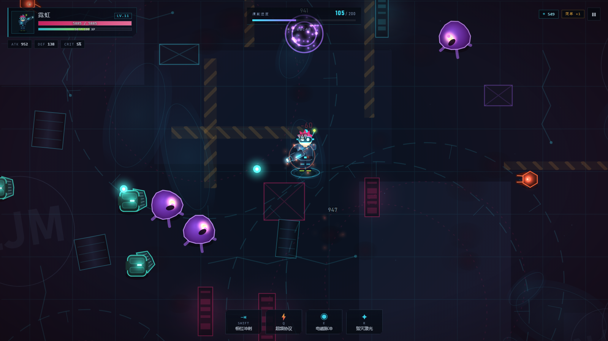
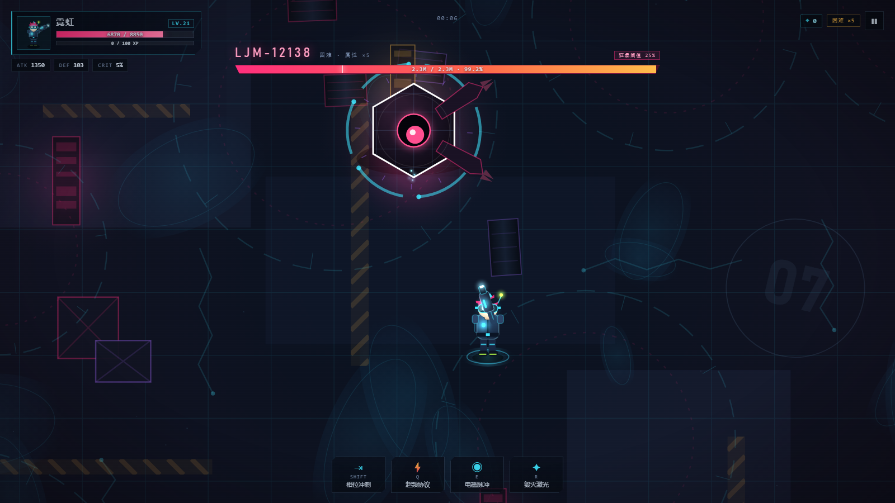
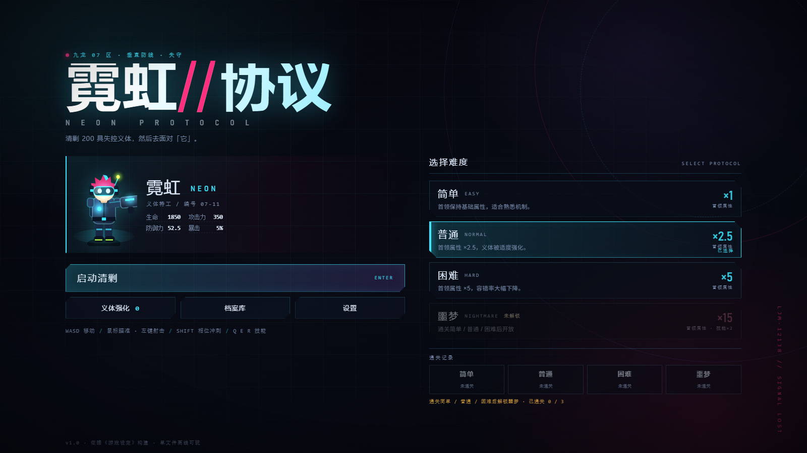
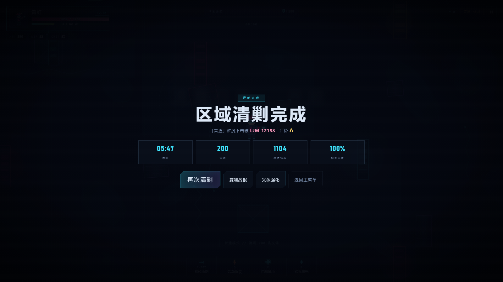

# 霓虹协议 · NEON PROTOCOL

赛博朋克 2D 俯视角枪战网页游戏。清剿 200 具失控义体，然后面对原型机 **LJM-12138**。

纯前端单文件，没有任何依赖、不需要服务器，打开网页就能玩。

> **在线试玩**：`https://你的用户名.github.io/仓库名/`
> （上传并开启 GitHub Pages 后把这一行换成你自己的链接）



## 玩法

- 战场里会分批刷出 **200 具义体**，每击杀一具获得 **10 点经验** 与 **3~8 枚钻石**。
- 每 **100 经验**升 1 级，升级时三选一拿一张**协议卡**（22 种：伤害、射速、暴击、穿透、多重弹道、吸血、冷却……）。
- 经验只在本关有效；**钻石永久保存**，可用来强化生命 / 攻击 / 防御 / 攻速 / 暴击 / 冷却。
- 200 具清光后首领登场；首领血量降到 **25%** 时狂暴，立刻释放一次 90% 攻击力的震荡，并把技能频率提高 25%。
- 通关简单 / 普通 / 困难后解锁 **噩梦**：首领属性 ×15、技能频率翻倍。

## 操作

| 按键 | 功能 |
| --- | --- |
| `W A S D` / 方向键 | 移动 |
| 鼠标 | 瞄准 |
| 左键 / `空格` | 射击（可在设置里开自动射击）|
| `SHIFT` | 相位冲刺（冲刺期间免疫伤害）|
| `Q` | 超频协议（攻速 +300%、伤害 +150%、吸血 20%）|
| `E` | 电磁脉冲（范围压制 5 秒 + 回复 50% 生命）|
| `R` | 毁灭激光（贯穿光束）|
| `1` `2` `3` | 升级时快速选卡 |
| `ESC` | 暂停 |
| `M` | 静音 |

## 首领 · LJM-12138

基础生命 1,000,000 / 攻击 3500 / 防御 1000（含「终焉充能」：实际生命随玩家等级 ×1~1.2），五个专属技能：

| 技能 | 说明 |
| --- | --- |
| 瞬移被刺 | 瞬移到背后突刺 `900 + 0.2×攻击 + 10×秒数`，落地后 **5 秒无敌**（噩梦 10 秒）|
| 残影分身 | 召唤继承 80% 攻击的分身，持续 `15 + 0.2×登场秒数` 秒 |
| 终焉冲锋 | 预警后冲刺，沿途留下 **每秒 500** 伤害的火焰；撞击 `2000 + 0.3×攻击 + 5×秒数` |
| 护盾 | **20 秒**内受伤 **-60%**，结束时回复 **30%** 生命 |
| 全向弹幕 | 向四周发射密集子弹，每发 `1000 + 0.15×攻击 + 8×秒数` |



## 截图

| | |
| --- | --- |
|  |  |

## 文件结构

```
index.html          游戏本体（单文件，已内联全部 CSS/JS，GitHub Pages 入口）
.nojekyll           关闭 Jekyll 处理，确保静态文件原样发布
shots/              截图
src/                开发源码
 ├─ dev.html         开发版页面（外链 css/js，方便调试）
 ├─ style.css
 ├─ core.js          工具 / 存档 / 合成音效 / 输入 / 相机 / 角色绘制
 ├─ cards.js         协议卡与属性结算
 ├─ entities.js      玩家 / 敌人 / 子弹 / 掉落
 ├─ boss.js          首领与分身
 ├─ game.js          状态机 / 刷怪 / 战斗 / 渲染 / 界面
 ├─ build.ps1        把 dev.html + 源码内联成根目录 index.html
 └─ test/headless.cjs 无头冒烟测试（14 项）
```

## 本地开发

```powershell
# 重新打包（系统默认禁用脚本，需要 Bypass）
powershell -ExecutionPolicy Bypass -File .\src\build.ps1

# 跑测试（需要 Node）
node .\src\test\headless.cjs
```

开发时也可以直接打开 `src/dev.html`。

## 说明

- 音效与背景音乐全部由 Web Audio API 实时合成，**没有任何外部音频或图片资源**。
- 存档保存在浏览器 localStorage；游戏内「设置 → 存档分享码」可以把进度导出成一段代码发给别人。
- 设计依据《游戏设定》实现，只对原设定未规定的部分做了补充（防御减伤封顶 70%、瞬移与护盾冷却不随难度缩短、分身耐久削弱等），全部写在游戏内「档案库 → 设计补充说明」里。

## 授权

随便玩、随便改、随便分享。